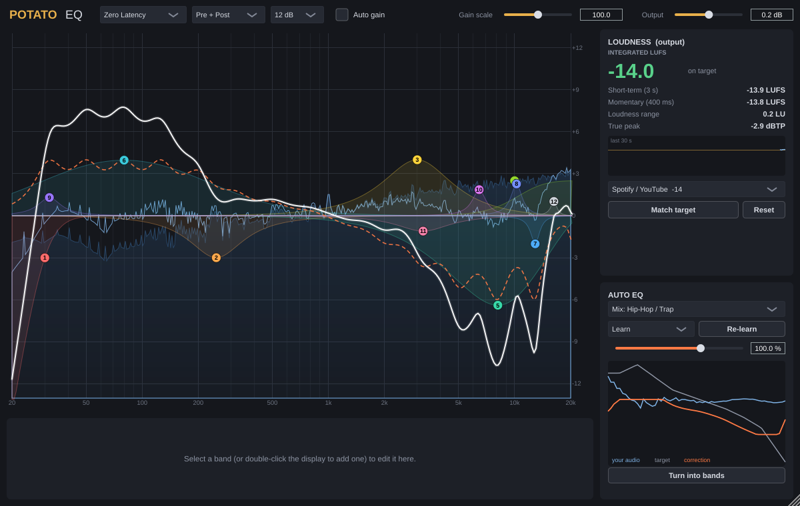

# Potato EQ

A 24-band parametric EQ (VST3 / AU / standalone) with a built-in LUFS meter and an
**Auto EQ** that listens to your audio and steers its tonal balance toward a
genre or instrument target curve.



## Download

Every push to `main` builds the plugin for Windows, macOS and Linux on GitHub's servers.
Open the **Actions** tab → the latest **Build plugin** run → **Artifacts**, and download
`PotatoEQ-Windows` (or `-macOS`). Installation steps are in `INSTALL.txt` inside the download.

Pushing a tag like `v0.1.0` also creates a GitHub Release with the zips attached.

## Features

**EQ**
- 24 bands: Bell, Low/High Shelf, Low/High Cut, Notch, Band Pass, Tilt Shelf
- Cut slopes 6 – 96 dB/oct; shelves 6 or 12 dB/oct; resonant Q on cuts
- Per-band stereo placement: Stereo, Left, Right, Mid, Side
- **Dynamic EQ** per band (bell and shelves): threshold + range, ~2:1 action
- **Zero Latency** (smooth, modulation-safe SVF filters) or **Linear Phase** (FIR, ~170 ms latency at 48 kHz)
- Gain scale (shrink/exaggerate every band at once), output gain, auto-gain
- Pre/post spectrum analyzer with a 4.5 dB/oct tilt
- Drag nodes to move, scroll for Q, double-click to add or bypass, right-click for options, Alt-click to delete.
  Shift = fine adjust, Ctrl/Cmd = frequency only.

**Loudness (ITU-R BS.1770-4 / EBU R128)**
- Momentary, short-term, gated integrated LUFS, loudness range (LRA), 4×-oversampled true peak
- Targets: Spotify/YouTube −14, Apple −16, club −9, loud −8, hip-hop/EDM −11, broadcast −23, podcast −16
- **Match target** sets the output gain to hit the target while keeping true peak ≤ −1 dBTP.
  Anything louder needs a limiter after the EQ.

**Auto EQ**
- Profiles for full mixes (Balanced, Hip-Hop/Trap, EDM, Dubstep/DnB, Pop, R&B, Rock, Lo-fi, Acoustic/Jazz)
  and sources (lead/backing vocals, kick, snare, drum bus, bass/808, guitars, keys, synth lead/pad)
- **Learn**: listens to ~12 s of non-silent audio, then holds the correction (saved with your project)
- **Live**: keeps listening (about a 6 s memory) and glides the EQ as the song changes
- Compares your long-term spectrum with the profile's target, smooths the difference to 1/3 octave,
  limits it (mixes: +4 / −6 dB, sources: up to +6 / −9 dB), never boosts empty regions,
  and adds the profile's high-pass for sources
- **Amount** 0–150 %, and **Turn into bands** converts the result into ordinary editable bands

The target curves are smooth tonal-balance references, based on the typical long-term
spectra of commercial releases. They are starting points to steer toward, not rules;
trust your ears and your reference tracks.

## Building yourself

Needs CMake 3.22+ and a C++20 compiler (Visual Studio 2022, Xcode 15+, or GCC 11+/Clang 14+).

```bash
cmake -S . -B build -DCMAKE_BUILD_TYPE=Release
cmake --build build --config Release
ctest --test-dir build -C Release        # DSP accuracy tests
```

JUCE 9.0.5 is downloaded automatically. Pass `-DJUCE_DIR=/path/to/JUCE` to use a local copy.

## Layout

```
Source/dsp/Filters.h      filter design + exact response math (TPT state-variable filters)
Source/dsp/EqEngine.h     zero-latency engine: 24 bands, M/S, dynamic EQ, auto layer
Source/dsp/Loudness.*     BS.1770 meter (K-weighting, gating, LRA, true peak)
Source/dsp/AutoEq.*       target profiles, spectrum → correction fit, curve → bands
Source/PluginProcessor.*  parameters, linear-phase FIR builder, learning, state
Source/ui/*               display, band/loudness/auto panels, look and feel
tests/DspTests.cpp        filter, engine, EBU loudness and auto-EQ tests
tests/PluginHarness.cpp   end-to-end plugin check + editor screenshot
```

Plugin made with [JUCE](https://juce.com). JUCE is dual-licensed (AGPLv3 or commercial).
If you plan to sell this plugin closed-source, you need a JUCE commercial licence (free tier available for small revenue).
